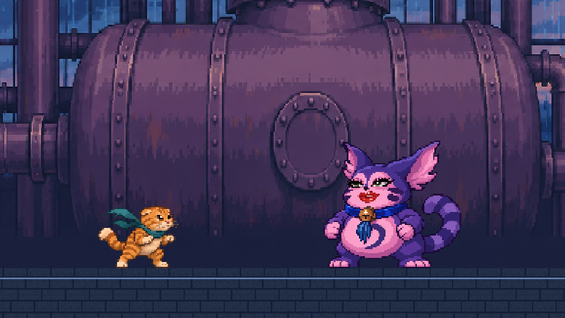

# 橘猫突围：最后一罐

> 雨夜出发。天亮前，带着最后一罐回家。

《橘猫突围：最后一罐》是一款用 **Unity 6.3 LTS** 制作的 **2D 像素横版动作游戏**。选择哈橘或姜爪，穿过雨夜仓库、冷库和装卸台，一路登上屋顶，在机房里迎战罐头守卫。


## 开始试玩

需要 **Unity 6000.3.28f1**、Git 和 **Git LFS**。图像和音频资源包含 LFS 文件。

```bash
git lfs install
git clone https://github.com/2294908165/OrangeCatBreakout.git
cd OrangeCatBreakout
git lfs pull
```

1. 在 Unity Hub 选择 **Add project from disk**，打开克隆得到的 `OrangeCatBreakout` 文件夹。
2. 等待 Unity 导入项目和依赖。在 **Project** 面板打开 [TitleScreen.unity](Assets/Game/Scenes/TitleScreen.unity)。
3. 点 **Play**，然后点击 **开始游戏**。也可以按 **Enter**、**空格**或手柄南键。

标题场景已排在构建场景列表首位。需要单独试招时，可以打开 [PixelPreview.unity](Assets/Game/Scenes/PixelPreview.unity)。

## 操作

| 动作 | 键盘 | 手柄 |
| --- | --- | --- |
| 移动 | A / D 或 ← / → | 左摇杆 |
| 跳跃、二段跳 | 空格 | 南键（Xbox A） |
| 普通攻击 | J | 西键（Xbox X） |
| 翻滚 | 左 Shift | 东键（Xbox B） |
| 哈橘哈气 | Q | 右肩键 |
| 姜爪格挡 | K | 左肩键 |
| 交互、续关 | E | 北键（Xbox Y） |
| 暂停 | Esc | Start |
| 重试当前关 | R | 倒地后按南键 |

**哈橘**能连按三次 J 打出低扫、上挑和双爪下劈，也能哈气打出近距离声波。**姜爪**可以架爪格挡，触发完美格挡后按 J 反击。标题界面按 M 可切换音乐。

## 五关路线

| 关卡 | 要做什么 |
| --- | --- |
| [01 雨夜仓库](docs/warehouse01.md) | 越过蒸汽井盖、地刺和工业风轮，击败流浪老鼠。 |
| [02 冷库输送线](docs/cold_storage02.md) | 借输送带移动，躲开飞虫俯冲，打通装卸出口。 |
| [03 装卸升降台](docs/loading_bay03.md) | 打断笑肚怪的肚顶，或从它身边绕过。呼叫货梯，乘梯到顶后自动前往屋顶。 |
| [04 屋顶检修区](docs/rooftop04.md) | 跳过排汽口，开启 A、B 两处电闸，再从绿色出口撤离。 |
| [05 罐头守卫](docs/can_guard05.md) | 读冲撞和砸地预警，抓住收招空档反打。拿到最后一罐后自动进入结局。 |

第一、二、四关通关后按 **E** 续关。倒地时可重试当前关或返回标题。通关后可选择再开一局，也可以回到双猫跳舞的标题界面。

| 屋顶机房 | 结局 |
| --- | --- |
|  |  |

## 工程结构与测试

| 目录 | 内容 |
| --- | --- |
| `Assets/Game/Scenes` | 标题、五关、结局及开发测试场景 |
| `Assets/Game/Scripts` | 角色状态机、战斗判定、敌人、机关和关卡流程 |
| `Assets/Game/Prefabs` · `Assets/Game/Data` | 角色和敌人预制体、攻击与角色数值、输入配置 |
| `Assets/Game/Art` · `Assets/Game/Audio` | 游戏内像素素材、音乐和音效 |
| `Assets/Game/Editor` · `Assets/Game/Tests` | 场景构建工具和 Unity 测试 |
| `ArtSource` · `docs` | 美术源图、预览及关卡说明 |

输入由 Unity Input System 读取，角色移动和攻击判定使用固定物理步长。角色状态机与像素动画分开，攻击判定、受击判定以及角色参数分别配置。

在 Unity 打开 **Window → General → Test Runner**，分别运行 **EditMode** 和 **PlayMode**。PlayMode 用例覆盖角色控制、攻击判定、关卡推进、标题启动和拾罐后进入结局。保存手头场景后再运行测试，因为用例会切换场景。

更多实现细节见[像素角色动作](docs/pixel_motion.md)、[标题界面](docs/title_screen.md)和[结局界面](docs/ending_screen.md)。

## 素材说明

美术源图及生成记录见各关卡和界面的说明。第一、二、四关和结局使用项目制作的合成器音乐。标题、第三关和 Boss 关使用项目作者提供的音频片段。仓库目前没有单独的许可证文件。
